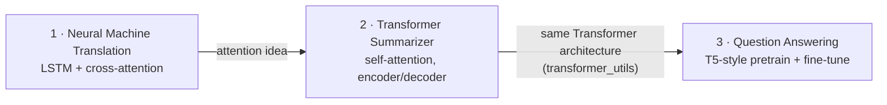
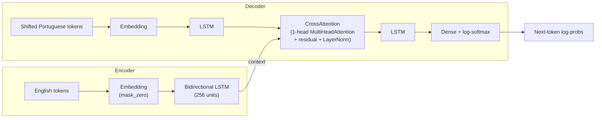
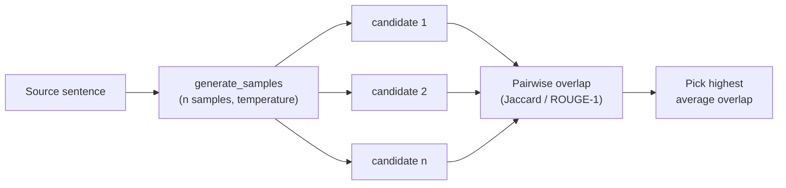
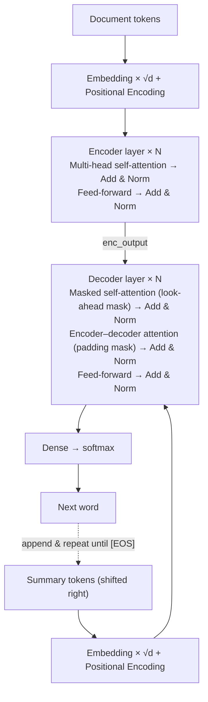
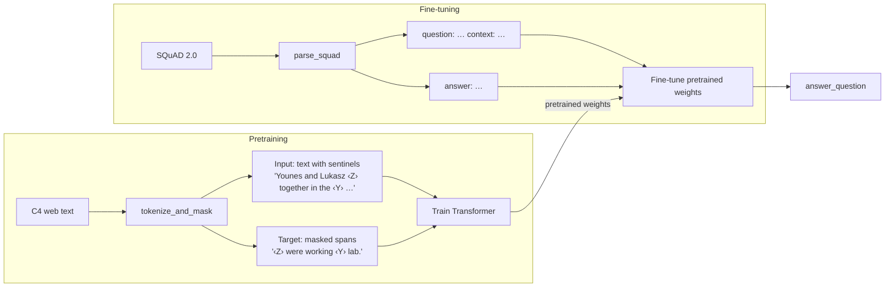

# NLP Transformer Lab

Three Coursera NLP assignments on attention-based models, written in TensorFlow/Keras. They follow a progression: an RNN with attention, then a Transformer built from scratch, then that Transformer reused as a T5-style model for question answering.

| # | Notebook | Task | Model | Data |
|---|----------|------|-------|------|
| 1 | [Neural Machine Translation.ipynb](Neural%20Machine%20Translation.ipynb) | English → Portuguese translation | Bi-LSTM encoder–decoder with cross-attention | English–Portuguese sentence pairs |
| 2 | [Transformer Summarize.ipynb](Transformer%20Summarize.ipynb) | Abstractive summarization | Encoder–decoder Transformer built from scratch | Document/summary corpus (`data/corpus`) |
| 3 | [Question Answering.ipynb](Question%20Answering.ipynb) | Question answering | T5-style Transformer, pretrained then fine-tuned | C4 (pretraining), SQuAD 2.0 (fine-tuning) |

## Repository structure

```
.
├── Neural Machine Translation.ipynb   # Assignment 1: seq2seq + attention, greedy & MBR decoding
├── Transformer Summarize.ipynb        # Assignment 2: full Transformer from scratch
├── Question Answering.ipynb           # Assignment 3: T5 pretraining (C4) + QA fine-tuning (SQuAD)
└── README.md
```

## How the assignments connect



---

## 1. Neural Machine Translation

An encoder–decoder RNN with attention that translates English sentences into Portuguese.

**Notebook sections**
1. Data preparation: `TextVectorization` vocabularies (12,000 tokens), `StringLookup` for id↔word mapping, batches of 64
2. Model: `Encoder`, `CrossAttention`, `Decoder`, `Translator`
3. Training: `compile_and_train`
4. Inference: `generate_next_token`, `translate` (greedy / temperature sampling)
5. Minimum Bayes-Risk (MBR) decoding: `generate_samples`, `jaccard_similarity`, `rouge1_similarity`, `average_overlap`, `weighted_avg_overlap`, `mbr_decode`

**Architecture**



**MBR decoding** draws several candidate translations, scores each by its average similarity to the others (Jaccard or ROUGE-1), and returns the candidate that agrees most with the rest:



---

## 2. Transformer Summarizer

A full Transformer implemented layer by layer and trained to generate summaries.

**Notebook sections**
1–2. Load the dataset (`utils.get_train_test_data`) and preprocess it, adding `[SOS]`/`[EOS]` tokens
3. `positional_encoding`
4. Masks: `create_padding_mask`, `create_look_ahead_mask`
5. `scaled_dot_product_attention`
6. Encoder: `FullyConnected`, `EncoderLayer`, `Encoder`
7. Decoder: `DecoderLayer`, `Decoder`
8. `Transformer` model
9–10. Initialization and training setup: `CustomSchedule` (warmup learning rate), `masked_loss`, `train_step`
11. Inference: `next_word`, `summarize`
12–13. Training and sample summaries

**Architecture**



Configuration used for training: `num_layers=2`, `embedding_dim=128`, `num_heads=2`, `fully_connected_dim=128`, `encoder_maxlen=150`.

---

## 3. Question Answering (T5-style)

The Transformer from assignment 2 (provided as `transformer_utils`) is pretrained with a masked-span objective on C4, then fine-tuned on SQuAD 2.0.

**Notebook sections**
1. Pretraining data
   - The C4 dataset and the masked-language-model objective
   - `get_sentinels`, `pretty_decode`: map sentinel tokens to readable markers
   - `tokenize_and_mask`: randomly drop tokens into sentinel-marked targets
   - `display_input_target_pairs`
2. Pretraining: instantiate `transformer_utils.Transformer`, train with `CustomSchedule`, then load provided pretrained weights
3. Fine-tuning
   - `parse_squad`: build `question: … context: …` → answer pairs
   - Fine-tune the pretrained model
   - `answer_question`: generate answers token by token with `transformer_utils.next_word`

**Pipeline**



---

## Running the notebooks

The notebooks import helper modules and data that came with the Coursera lab environment and are **not included in this repository**:

| Notebook | Required files |
|----------|----------------|
| Neural Machine Translation | `utils.py`, `w1_unittest.py`, translation data |
| Transformer Summarize | `utils.py`, `w2_unittest.py`, `data/corpus/` |
| Question Answering | `utils.py`, `transformer_utils.py`, `w3_unittest.py`, C4 / SQuAD data, `pretrained_models/` |

To run them outside Coursera, download those files from the lab workspace and put them next to the notebooks. Main dependencies: `tensorflow`, `tensorflow_text`, `numpy`, `pandas`, `matplotlib`, `termcolor`.
